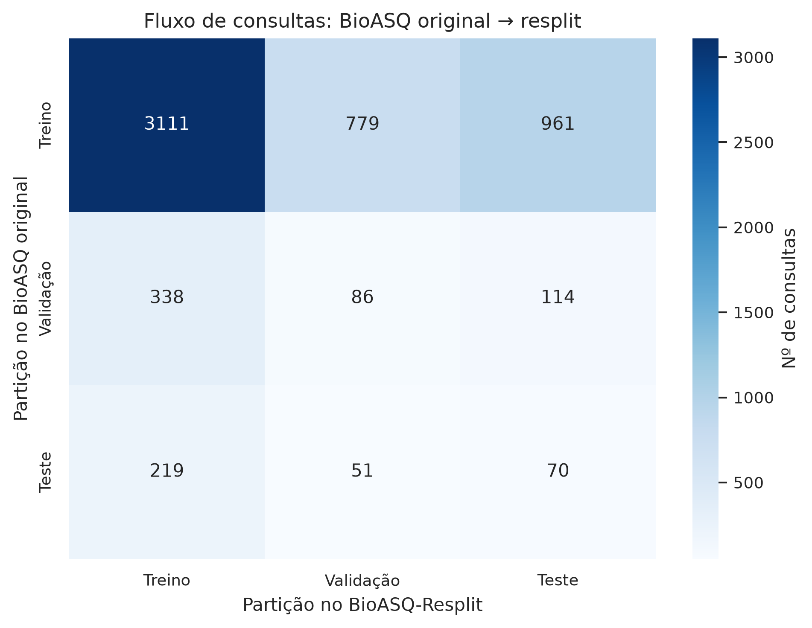
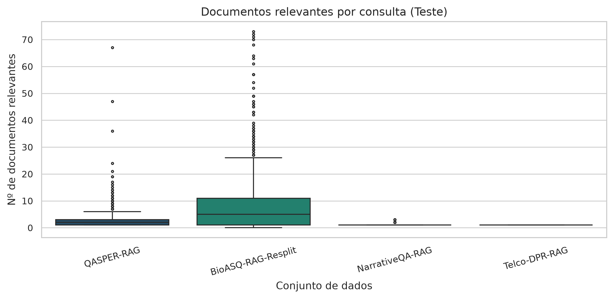
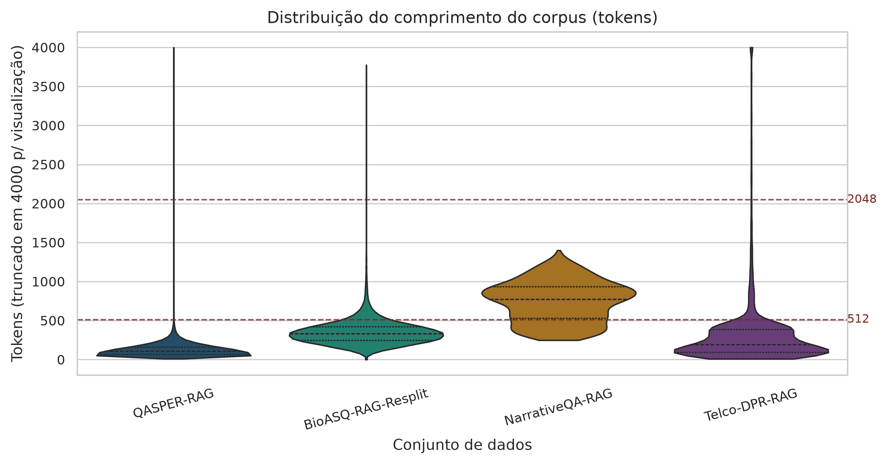
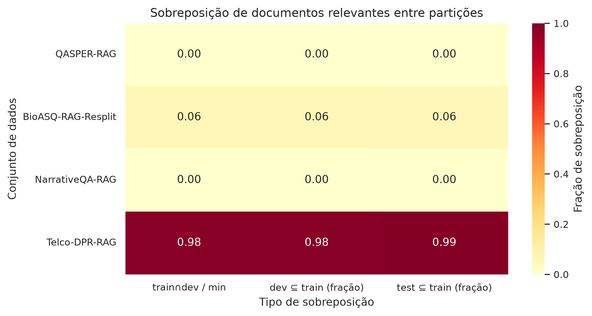

# Capítulo 3 — Benchmark para Avaliação End-to-End de Sistemas RAG

## 3.1 Introdução

A avaliação de sistemas de Geração Aumentada por Recuperação (*Retrieval-Augmented Generation*, RAG) em domínios especializados exige mais do que métricas isoladas de recuperação de informação (IR) ou de resposta a perguntas (QA). Em cenários de domínio fechado, o desempenho observado depende simultaneamente da capacidade do recuperador em identificar evidências relevantes e da capacidade do gerador em sintetizar respostas factualmente ancoradas nessas evidências. Benchmarks consolidados como o BEIR~\cite{thakur2021beirheterogenousbenchmarkzeroshot} e o MTEB~\cite{muennighoff2023mtebmassivetextembedding} padronizam a avaliação de *embeddings* e de IR em múltiplas tarefas, porém não oferecem, de forma unificada, (i) respostas de referência alinhadas às mesmas consultas, (ii) partições treináveis adequadas a ajuste fino eficiente e (iii) cobertura sistemática de domínios técnicos fechados.

Este capítulo responde ao Objetivo Específico OE1 e descreve a construção de um *benchmark* padronizado para avaliação *end-to-end* de pipelines RAG. O *suite* adapta quatro conjuntos de dados — QASPER~\cite{dasigi-etal-2021-dataset}, BioASQ~\cite{muller_bioasq_2015}, NarrativeQA~\cite{narrativeqa} e Telco-DPR~\cite{10978393} — a um formato comum inspirado em BEIR/MTEB, estendido com anotações de resposta. A Seção~3.2 formaliza os requisitos e o esquema de dados; a Seção~3.3 justifica a seleção dos domínios; a Seção~3.4 detalha o *pipeline* de construção; a Seção~3.5 descreve a adaptação de cada fonte; a Seção~3.6 apresenta a caracterização estatística; a Seção~3.7 define o protocolo de avaliação; e a Seção~3.8 discute limitações e ameaças à validade.

## 3.2 Requisitos de projeto e formato padronizado

O *benchmark* foi projetado para satisfazer cinco requisitos:

1. **Domínio fechado:** cada conjunto concentra-se em um corpus especializado, com terminologia e distribuição distintas do pré-treinamento genérico.
2. **Evidência anotada:** cada consulta possui *qrels* que vinculam a pergunta a passagens relevantes do corpus.
3. **Respostas de referência:** além da relevância, cada consulta possui ao menos uma resposta textual, viabilizando métricas de geração.
4. **Partições treináveis:** *train* / *dev* / *test* permitem ajuste fino (PEFT/LoRA) e seleção de hiperparâmetros sem contaminação da avaliação final por IDs de consulta.
5. **Compatibilidade operacional:** o formato deve ser carregável por adaptadores MTEB para IR e por *pipelines* de geração (RAGAS / métricas com referência).

O esquema resultante é BEIR-like, publicado no Hugging Face Hub com *configs* distintos:

| Subconjunto | Campos principais | Função |
|---|---|---|
| `corpus` | `id`, `title`, `text` (+ `section_name` no QASPER) | Memória não paramétrica indexável |
| `queries` | `id`, `text` | Consultas por partição |
| `qrels` | `query_id`, `corpus_id`, `score` | Relevância binária |
| `answers` | `query_id`, `answer` | Referência para avaliação de geração |
| `top_ranked` *(apenas QASPER)* | `query-id`, `corpus-ids` | Pool candidato restrito ao artigo da consulta |
| `retrieved_docs` *(opcional)* | `query_id`, `corpus_id`, `rank`, `is_relevant` | Ponte entre recuperação e geração |

O corpus é compartilhado entre as partições (padrão BEIR): o que muda entre *train*, *dev* e *test* são as consultas, os *qrels* e as respostas. Essa escolha facilita a indexação única, mas exige análise explícita de *leakage* de documentos relevantes entre partições (Seção~3.6.3).

Os artefatos públicos utilizados nesta dissertação são:

| Conjunto | Repositório Hub |
|---|---|
| QASPER-RAG | `DinoStackAI/qasper-rag` |
| BioASQ-RAG-Resplit | `DinoStackAI/bioasq-rag-13b-resplit` |
| NarrativeQA-RAG | `DinoStackAI/narrativeqa-rag` |
| Telco-DPR-RAG | `DinoStackAI/telco-dpr-rag` |

## 3.3 Seleção dos domínios

Quatro domínios foram selecionados para cobrir eixos ortogonais de dificuldade em RAG, sem pretender exaustividade temática:

| Eixo | QASPER | BioASQ | NarrativeQA | Telco-DPR |
|---|---|---|---|---|
| Domínio | Papers de PLN | Biomedicina | Narrativa | Telecomunicações |
| Unidade indexada | Parágrafo / abstract | Abstract PubMed | *Summary* do documento | Passagem técnica |
| Relevants / consulta | Poucos (multi-evidência) | Muitos | Tipicamente 1 | Exatamente 1 |
| Desafio dominante | Evidência local + *paper-scoped* | Multi-documento | Contexto longo | Vocabulário técnico + corpus diluído |

Essa diversidade permite avaliar se ganhos de *Context-aware RAG Fine-Tuning* generalizam além de um único domínio, e se falhas (por exemplo, *query drift* ou incapacidade de rejeitar contexto irrelevante) são específicas de um regime de relevância.

## 3.4 Pipeline de construção

A Figura conceitual do *pipeline* é a seguinte:

```text
Fonte bruta
  → filtragem / chunking / alinhamento de evidência
  → construção de qrels e answers
  → definição das partições (train/dev/test)
  → DatasetDict Hugging Face (corpus, queries, qrels, answers, …)
  → publicação no Hub
  → consumo por MTEB (IR) e por pipelines de geração
```

Scripts de construção residem em `scripts/create_dataset/`; a análise descritiva reportada neste capítulo foi gerada com `scripts/benchmark/analyze_rag_benchmark.py`, utilizando o tokenizer `Qwen/Qwen3-Embedding-4B` — o mesmo empregado nos experimentos de *embeddings* dos capítulos seguintes — e a formatação textual idêntica à da indexação/avaliação.

## 3.5 Adaptação dos conjuntos de dados

### 3.5.1 QASPER-RAG

**Fonte.** `allenai/qasper`~\cite{dasigi-etal-2021-dataset}, perguntas sobre artigos científicos de PLN com evidências anotadas.

**Corpus.** Cada artigo é segmentado em um *chunk* de *abstract* e um *chunk* por parágrafo do texto completo. O identificador segue o padrão `{paper_id}_{índice}`. O texto indexado concatena `title`, `section_name` e `text`.

**Relevância e resposta.** Evidências textuais são alinhadas aos *chunks* por correspondência normalizada. Consultas não respondíveis e anotações do tipo `FLOAT SELECTED` são descartadas. A resposta de referência é escolhida entre as anotações disponíveis (preferindo a forma livre / extrativa / sim-não mais longa, conforme o tipo).

**Partições.** A partição `validation` original é mapeada para `dev`. O corpus é compartilhado; no nível de *paper* das evidências relevantes, as partições são disjuntas (Seção~3.6.3).

**Modo paper-scoped.** Além da recuperação sobre o corpus completo, o subconjunto `top_ranked` restringe os candidatos aos *chunks* do mesmo artigo da consulta, permitindo avaliar IR em *pool* reduzido — cenário alinhado ao uso original do QASPER.

### 3.5.2 BioASQ-RAG e BioASQ-RAG-Resplit

**Fonte.** Dados de treinamento e *golden* da Task 13B do BioASQ~\cite{muller_bioasq_2015}.

**Corpus.** Abstracts PubMed associados a *snippets* com `beginSection = endSection = abstract`, obtidos via NCBI. Cada documento é um PMID.

**Relevância e resposta.** Um *qrel* por par (consulta, PMID); a resposta é o `ideal_answer` mais longo.

**Partição original.** No *release* original deste *benchmark*, o conjunto *golden* 13B1–4 formava o teste (340 consultas), enquanto treino/validação derivavam do treinamento 13B com *hold-out* de 10% (semente 42). Esse teste é estatisticamente pequeno para comparar de forma estável variantes de ajuste fino.

**Resplit.** Por isso, as 5.729 consultas foram reunidas, embaralhadas com semente 42 e redistribuídas: 20% para teste e, do restante, 20% para validação. O corpus permanece o mesmo. A Figura~3.1 mostra a matriz de transição entre a partição original e o *resplit*. Em particular, das 340 consultas do teste *golden* original, apenas 70 permanecem no teste do *resplit* (219 migram para treino e 51 para validação). **Todos os experimentos desta dissertação que reportam BioASQ utilizam a variante resplit**, salvo menção explícita em contrário.



**Figura 3.1.** Transição das consultas entre a partição BioASQ original e a variante *resplit*. Células indicam o número de consultas.

### 3.5.3 NarrativeQA-RAG

**Fonte.** `deepmind/narrativeqa`~\cite{narrativeqa}.

**Corpus.** Utilizam-se apenas os *summaries* Wikipedia dos documentos (título + texto), e não o texto integral dos livros/roteiros. Essa decisão reduz o custo de indexação e alinha o corpus a um regime de contexto longo, porém ainda tratável por modelos densos de janela limitada.

**Relevância e resposta.** Em geral, há uma relação 1:1 entre consulta e documento; a resposta de referência é a anotação mais longa disponível. A partição `validation` original é mapeada para `dev`. No nível de documento relevante, as partições são disjuntas.

### 3.5.4 Telco-DPR-RAG

**Fonte.** `thainasaraiva/Telco-DPR`~\cite{10978393}, domínio de telecomunicações.

**Corpus.** União das partições `small` e `extended` de passagens; o título indexado combina título do documento e nome da seção, e o texto incorpora, quando presente, tabelas e seus resumos.

**Relevância e resposta.** Tipicamente um documento relevante por consulta; a resposta vem do campo `answer` da fonte. A validação é obtida reservando 20% do treino original (semente 42).

**Característica estrutural.** Apenas cerca de 1,9% do corpus aparece como relevante em alguma partição. Além disso, há forte sobreposição de documentos relevantes entre treino e teste (Seção~3.6.3), o que deve ser considerado ao interpretar ganhos de ajuste fino neste domínio.

## 3.6 Caracterização estatística

As estatísticas desta seção foram calculadas sobre os artefatos publicados no Hub, com contagem de *tokens* pelo tokenizer `Qwen/Qwen3-Embedding-4B` e formatação textual idêntica à usada na avaliação.

### 3.6.1 Visão geral do *suite*

A Tabela~3.1 resume o *benchmark*. Observa-se heterogeneidade intencional: QASPER e BioASQ oferecem corpora densos com múltiplas evidências; NarrativeQA concentra muitas consultas sobre poucos documentos longos; Telco-DPR combina corpus moderado com relevância estritamente singular.

| Conjunto | Domínio | Corpus | Treino | Validação | Teste | Relevants/consulta (teste) | Unidade do corpus |
|---|---|---:|---:|---:|---:|---:|---|
| QASPER-RAG | Literatura científica (PLN) | 81.550 | 2.101 | 890 | 1.310 | 2,62 | Parágrafo / abstract |
| BioASQ-RAG-Resplit | Biomedicina | 44.183 | 3.668 | 916 | 1.145 | 8,28 | Abstract PubMed |
| NarrativeQA-RAG | Narrativa / literatura | 1.572 | 32.507 | 3.425 | 10.479 | 1,01 | *Summary* |
| Telco-DPR-RAG | Telecomunicações | 14.654 | 975 | 243 | 523 | 1,00 | Passagem técnica |

**Tabela 3.1.** Visão geral dos conjuntos do *benchmark* RAG. Contagens de consulta referem-se a IDs únicos.

A Figura~3.2 complementariza a Tabela~3.1 ao evidenciar a multiplicidade de documentos relevantes por consulta no conjunto de teste: BioASQ concentra o regime multi-documento, enquanto NarrativeQA e Telco-DPR são essencialmente 1:1.



**Figura 3.2.** Distribuição do número de documentos relevantes por consulta no *split* de teste.

### 3.6.2 Comprimentos e assimetria consulta–documento

A Tabela~3.2 e a Figura~3.3 caracterizam o comprimento do corpus e das consultas de teste. As linhas verticais de referência em 512 e 2.048 *tokens* (Figura~3.3) correspondem a orçamentos típicos de modelos de *embedding* e aos experimentos de contexto estendido reportados nos capítulos seguintes.

| Conjunto | Corpus — média / mediana / p95 / máx. (tokens) | Consulta (teste) — média / mediana / máx. |
|---|---|---|
| QASPER-RAG | 120,7 / 105 / 261 / 4.840 | 9,4 / 9 / 30 |
| BioASQ-RAG-Resplit | 346,3 / 330 / 594 / 3.776 | 13,6 / 13 / 46 |
| NarrativeQA-RAG | 745,0 / 772 / 1.169 / 1.399 | 11,0 / 10 / 34 |
| Telco-DPR-RAG | 343,5 / 191 / 893 / 38.934 | 22,1 / 21 / 47 |

**Tabela 3.2.** Estatísticas de comprimento em *tokens* (`Qwen/Qwen3-Embedding-4B`).



**Figura 3.3.** Distribuição do comprimento do corpus em *tokens*. A visualização trunca valores extremos em 4.000 apenas para legibilidade; os máximos reais constam da Tabela~3.2.

Dois padrões são relevantes para o desenho experimental:

- **Assimetria consulta–documento:** consultas são curtas (cerca de 9–22 *tokens*), enquanto documentos variam de ~120 *tokens* (QASPER) a ~745 (NarrativeQA), com cauda extrema no Telco-DPR (máximo de 38.934 *tokens*). Isso reforça o problema clássico de *vocabulary mismatch* e motiva tanto expansão de consultas quanto recuperação densa adaptada ao domínio.
- **Truncamento:** a maior parte dos documentos de QASPER e BioASQ cabe em 512 *tokens*, mas NarrativeQA e a cauda do Telco-DPR ultrapassam esse limite com frequência, justificando análises com janela maior (por exemplo, 2k).

### 3.6.3 Sobreposição entre partições

Não há sobreposição de IDs de consulta entre *train*, *dev* e *teste* em nenhum dos quatro conjuntos. Contudo, o corpus compartilhado permite que o **mesmo documento relevante** apareça associado a consultas de partições distintas. A Tabela~3.3 e a Figura~3.4 quantificam esse fenômeno.

| Conjunto | Nível | train ∩ test | Fração do teste também relevante no treino |
|---|---|---:|---:|
| QASPER-RAG | *chunk* relevante | 0 | 0,0% |
| QASPER-RAG | artigo (*paper*) | 0 | 0,0% |
| BioASQ-RAG-Resplit | PMID relevante | 529 | 5,6% |
| NarrativeQA-RAG | documento relevante | 0 | 0,0% |
| Telco-DPR-RAG | passagem relevante | 248 | **98,8%** |

**Tabela 3.3.** Sobreposição de documentos relevantes entre treino e teste.



**Figura 3.4.** Frações de sobreposição de documentos relevantes entre partições. Valores próximos de 1 indicam *leakage* severo no nível do documento relevante.

**Implicações.** QASPER e NarrativeQA são *document-disjoint* no que tange às evidências relevantes, o que fortalece a validade de avaliações com ajuste fino. BioASQ apresenta *leakage* moderado (~6% do teste), esperado em um corpus PubMed reutilizado por múltiplas perguntas. Telco-DPR, por outro lado, reutiliza quase todos os documentos relevantes do teste no treino: o ajuste fino pode memorizar passagens “sempre relevantes”, e ganhos absolutos neste domínio devem ser interpretados com cautela e, preferencialmente, contrastados com métricas de geração e com os demais domínios.

Adicionalmente, no BioASQ-*resplit*, 72 consultas de teste não possuem *qrels* de abstract após a filtragem da fonte; o *loader* MTEB remove consultas sem positivos, de modo que o *n* efetivo de avaliação pode ser inferior ao *n* do *dataset* bruto.

## 3.7 Protocolo de avaliação

O *benchmark* sustenta dois eixos de avaliação, reutilizados nos Capítulos~4–6.

### 3.7.1 Recuperação de informação

A avaliação de IR utiliza tarefas MTEB (`AbsTaskRetrieval`) com pontuação principal **nDCG@10**. Também se reportam Recall@*k*, MAP@*k*, MRR@*k* e Hit Rate@*k*, quando pertinente. O texto do corpus é formatado exatamente como na indexação; as consultas são encapsuladas no *template* de instrução do modelo de *embedding*. Configurações especiais incluem:

- recuperação sobre corpus completo versus *paper-scoped* (`top_ranked`) no QASPER;
- variantes com título do documento na consulta;
- recuperação em dois estágios / aumentada por contexto (RFG e *context-aware embedder*), detalhadas nos capítulos correspondentes.

### 3.7.2 Geração aumentada

Após a recuperação *top-k*, respostas geradas são avaliadas com:

- métricas com referência (BLEU, ROUGE, ChrF, *Exact Match*, similaridade semântica);
- métricas RAGAS centradas em correção da resposta (`answer_correctness`, similaridade semântica), com *faithfulness* desabilitado por padrão na configuração experimental desta dissertação.

Essa separação permite atribuir ganhos ao recuperador, ao gerador ou à interação entre ambos — núcleo da hipótese de *Context-aware RAG Fine-Tuning*.

## 3.8 Limitações e considerações de validade

1. **Corpus compartilhado ≠ ausência de *leakage*.** A disjunção de consultas não implica disjunção de documentos relevantes; Telco-DPR é o caso extremo.
2. **BioASQ-*resplit* altera o protocolo oficial da competição.** O *golden test* deixa de ser *hold-out* puro, em troca de maior estabilidade estatística para comparar métodos de FT.
3. **NarrativeQA usa *summaries*, não o texto narrativo completo.** Resultados não devem ser extrapolados para recuperação sobre livros integrais.
4. **Cauda longa de comprimento (Telco-DPR).** Truncamento em 512 ou mesmo 2.048 *tokens* pode descartar evidência; análises de robustez a janela são necessárias.
5. **Consultas sem positivos (BioASQ).** A filtragem a abstracts e a remoção automática no MTEB afetam o tamanho efetivo do teste.
6. **Escopo de domínio.** Quatro conjuntos não esgotam o espaço de domínios fechados; a generalização a outras áreas técnicas permanece hipótese empírica.

## 3.9 Disponibilização e reprodutibilidade

Os quatro conjuntos estão publicamente disponíveis no Hugging Face Hub (Seção~3.2). O código de construção (`scripts/create_dataset/`), o adaptador MTEB e o *script* de análise estatística (`scripts/benchmark/analyze_rag_benchmark.py`) acompanham o repositório desta dissertação. Sementes de embaralhamento/partição usam o valor 42, salvo indicação contrária. Tabelas e figuras deste capítulo podem ser regeneradas com:

```bash
python scripts/benchmark/analyze_rag_benchmark.py --local-files-only
```

Saída padrão: `reports/benchmark_cap3/`.

## 3.10 Síntese

Este capítulo apresentou um *benchmark* unificado para avaliação *end-to-end* de RAG em quatro domínios fechados, estendendo o espírito de BEIR/MTEB com respostas de referência e partições adequadas a PEFT. A caracterização revelou regimes distintos de relevância e de comprimento, bem como uma ameaça à validade crítica no Telco-DPR (sobreposição quase total de documentos relevantes entre treino e teste). O protocolo de IR (nDCG@10 via MTEB) e de geração (métricas com referência e RAGAS) definido aqui é o fio condutor experimental dos capítulos seguintes, nos quais se avaliam o ajuste fino ciente de contexto, o *framework* RFG e o *context-aware text embedder*.
